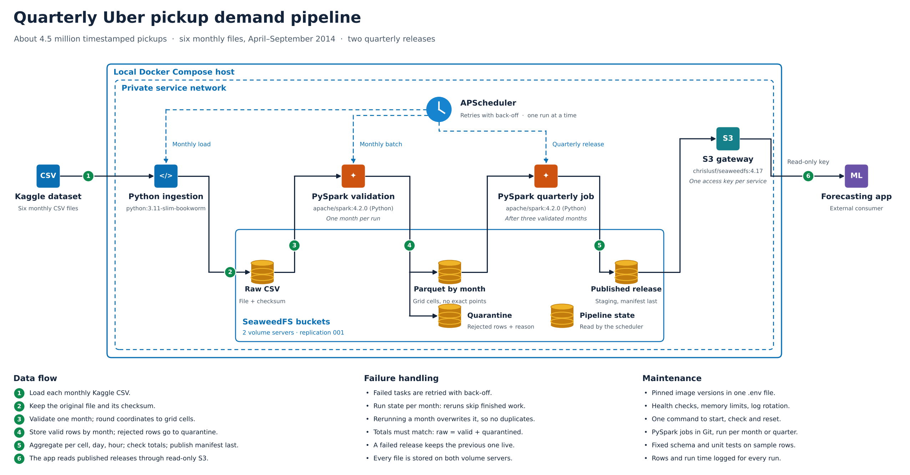

# Uber NYC batch pipeline

A batch-processing data architecture that turns raw Uber pickup records into
quarterly demand tables for a forecasting application. Every component runs
as an isolated Docker container, and the whole system is defined in this
repository (Infrastructure as Code).

Portfolio project for *Project: Data Engineering* (DLMDSEDE02),
IU International University of Applied Sciences.



## Build status

| Step | Component | Status |
|---|---|---|
| 1 | Repository skeleton | Done |
| 2 | Storage: SeaweedFS (master, 2 volume servers, filer, S3 gateway, buckets, access keys) | Done |
| 3 | Ingestion service (monthly CSV to `raw`, with checksum) | Done |
| 4 | PySpark monthly validation (`processed` and `quarantine`) | Done |
| 5 | PySpark quarterly job (staging, checks, publish manifest last) | Done |
| 6 | Scheduler: APScheduler with retries and run state | Done |
| 7 | Failure tests, run times, documentation | Done |

## Data

[Uber Pickups in New York City](https://www.kaggle.com/datasets/fivethirtyeight/uber-pickups-in-new-york-city)
(Kaggle, FiveThirtyEight). The pipeline uses the six monthly files from April
to September 2014, about 4.5 million pickups. Each row holds a pickup
timestamp, latitude, longitude and base code.

The files are not part of this repository. Fetch them once on your own
machine; the script copies the six 2014 files into `data/` and checks the
row total:

```bash
python3 -m venv .venv && source .venv/bin/activate
pip install kagglehub
python tools/fetch_data.py
```

## Requirements

- Docker Desktop with Docker Compose v2
- About 6 GB of memory assigned to Docker (all images run natively on
  Apple Silicon and on Intel/AMD)

## Quick start

```bash
git clone <repository-url>
cd uber-nyc-batch-pipeline
cp .env.example .env          # then replace every "change-me" value
docker compose up -d
```

## Check that storage works

```bash
# All services healthy; storage-init has exited with code 0
docker compose ps -a

# Buckets created
docker compose logs storage-init

# Two volume servers registered with the master
curl -s "http://localhost:9333/dir/status?pretty=y"

# Every access key can do exactly what it should
docker compose --profile check run --rm access-check
```

Web interfaces (this machine only): master <http://localhost:9333>,
filer <http://localhost:8888>.

## Run the ingestion

```bash
docker compose build ingestion
# one month
docker compose run --rm ingestion --month 2014-04   
# all six months
docker compose run --rm ingestion --all             
```

For each month the service checks the header, counts the rows and the
timestamps outside the month, computes the SHA-256 checksum, uploads the file
to `raw/year=2014/month=MM/` and writes `_ingest.json` next to it **last**.
Later jobs only read months that have this marker. Running a month again
skips it if the file is identical and refuses it if the file differs, because
raw files are never overwritten. Every run is recorded in
`pipeline-state/ingestion/<month>.json` with its status, row counts and timings.

Inspect the results (filer web interface, this machine only):

```bash
curl -s http://localhost:8888/buckets/raw/year=2014/month=04/_ingest.json
curl -s http://localhost:8888/buckets/pipeline-state/ingestion/2014-04.json
```

Tests for the ingestion logic (no extra packages needed):

```bash
python3 ingestion/tests/test_ingest.py
```

## Run the monthly validation (PySpark)

```bash
# first build takes several minutes
docker compose --profile jobs build spark          
# unit tests on sample rows
docker compose run --rm spark test                 
docker compose run --rm spark validate --month 2014-04
docker compose run --rm spark validate --all
```

The job reads a month only if its `_ingest.json` marker exists, checks that
Spark reads exactly the row count recorded by ingestion, and gives every row a
reject reason or none:

| Reason | Rule |
|---|---|
| `unreadable_timestamp` | Pickup time cannot be parsed |
| `outside_month` | Pickup time is not in the month of the file |
| `unreadable_coordinates` | Latitude or longitude is not a number |
| `outside_service_area` | Outside 39.5–41.5° N, 72–75° W (New York area incl. airports) |
| `invalid_base` | Base code is not of the form `B` + 5 digits |

Valid rows go to `processed/pickups/year=2014/month=MM/` as Parquet, with the
pickup reduced to a 0.01° grid cell (about 1 km): exact coordinates never
leave `raw` and `quarantine`. Rejected rows go to
`quarantine/pickups/year=2014/month=MM/` with their reason. `_validated.json`
is written last; running a month again skips it unless `--force` is given.
Every run is recorded in `pipeline-state/validation/<month>.json`.

```bash
curl -s http://localhost:8888/buckets/processed/pickups/year=2014/month=04/_validated.json
```

## Run the quarterly release (PySpark)

```bash
# validation and release tests
docker compose run --rm spark test                    
# 2014-Q2 and 2014-Q3
docker compose run --rm spark release --all           
curl -s "http://localhost:8888/buckets/published/quarter=2014-Q2/_manifest.json"
```

For each quarter the job requires `_validated.json` for all three months,
aggregates the processed rows into two tables and writes them into a new
release folder:

| Table | One row per | Columns |
|---|---|---|
| `demand_by_cell_hour` | grid cell, date and hour | `pickup_date`, `pickup_hour`, `day_of_week`, `cell_id`, `cell_lat`, `cell_lon`, `pickups` |
| `demand_by_base_day` | Uber base and date | `pickup_date`, `day_of_week`, `base`, `pickups` |

It reads both tables back and checks that each totals exactly the valid rows
recorded by validation. Only then does it write
`published/quarter=<q>/_manifest.json`, which is the single write that makes
the new release visible. Older release folders are kept, so a previous
release can be restored by pointing the manifest back to it.

### Forecasting app check (from this machine, read-only key)

```bash
source .venv/bin/activate
pip install "boto3~=1.35.0" pyarrow
python tools/forecast_app_check.py
```

Reads both releases through `localhost:8333` as the forecasting application
would, checks the totals against the manifests, and confirms that the
read-only key cannot write to `published` or read `raw` and `quarantine`.

### Failure test: interrupted release

```bash
docker compose run --rm spark release --quarter 2014-Q2 --force --fail-before-manifest
curl -s "http://localhost:8888/buckets/published/quarter=2014-Q2/_manifest.json"   # unchanged
python tools/forecast_app_check.py                                                 # still passes
```

The run writes complete tables into a new release folder and then stops
before the manifest. The manifest still names the previous release, so the
forecasting application keeps reading complete data.

## Scheduled operation (APScheduler)

`docker compose up -d --build` starts the whole pipeline. Besides storage it
runs two job workers and the scheduler:

| Service | Role |
|---|---|
| `ingestion-worker` | Ingestion image behind a small HTTP job server (`runner/job_server.py`) |
| `spark-worker` | PySpark image behind the same job server |
| `scheduler` | APScheduler; starts the cycles below and retries failed jobs |

| Cycle | Default time (UTC, set in `.env`) | Work |
|---|---|---|
| Monthly | `MONTHLY_CRON=0 2 1 * *` | For each month: ingest, then validate |
| Quarterly | `QUARTERLY_CRON=0 4 1 1,4,7,10 *` | Release each quarter |

With `RUN_ON_START=true` a catch-up run (monthly, then quarterly) starts as
soon as the stack is up, so a fresh deployment processes all data. Every job
skips work already done for the same source files, so cycles are safe to
repeat.

Design points:

- **No Docker socket.** The scheduler starts jobs by calling the workers'
  job server over the private network. The job server accepts only strictly
  formatted arguments, starts the command without a shell, and runs one job
  at a time.
- **Least privilege.** The scheduler holds no storage keys; each worker holds
  only its own job's key.
- **Retries.** Each job call is retried with back-off (`RETRY_DELAYS`). A
  worker that is down, busy or returns an error counts as a failed attempt.
  A month that fails ingestion is not validated in that cycle.
- **Persistence.** The timetable lives in a SQLite job store on the
  `scheduler-state` volume. After a restart it is restored; a run missed
  while the scheduler was down is started once (coalesced). Only one cycle
  runs at a time.

```bash
# watch the cycles
docker compose logs -f scheduler                                   
docker compose exec scheduler python /app/scheduler.py run-now monthly
docker compose exec scheduler python /app/scheduler.py run-now quarterly
# retry logic tests
python3 scheduler/tests/test_scheduler.py                          
```

### Failure test: worker down during a cycle

```bash
docker compose stop spark-worker
(sleep 25 && docker compose start spark-worker) &
docker compose exec -e RETRY_DELAYS=10,20,40 scheduler python /app/scheduler.py run-now monthly
```

The first validation attempts fail with "worker unreachable" and are retried;
once the worker is back, the cycle completes without manual help.

## Evidence

All evidence is produced by commands in this README and kept in
`docs/evidence/`:

| File | Shows |
|---|---|
| `step2-services.txt`, `step2-buckets.txt`, `step2-volume-servers.txt` | Storage healthy, buckets created, two volume servers with replication `001` |
| `step2-access-check.txt` | Every S3 key can do exactly what it should |
| `step2-dataset.txt` | Six source files, row counts and SHA-256 checksums |
| `step3-ingestion.txt` | All months ingested; a repeated month is skipped |
| `step4-validation.txt` | Validation per month, totals reconcile, rejected rows by reason |
| `step5-release.txt`, `step5-app-check.txt` | Both quarters published; app reads them with the read-only key |
| `step5-failure-test.txt` | Interrupted release leaves the previous release live |
| `step6-scheduler.txt`, `step6-retry-test.txt`, `step6-restart.txt` | Scheduled catch-up, retries while a worker is down, timetable restored after restart |
| `step7-clean-run.txt`, `run-report.md` | Full rebuild from empty storage, with run times per stage |
| `step7-replication.txt` | Releases still readable with one volume server stopped |

### Full rebuild from empty storage

```bash
# deletes all stored data; data/ and .env stay
docker compose down -v                  
# the scheduler processes everything again
docker compose up -d --build            
# wait for "quarterly cycle finished"
docker compose logs -f scheduler        
docker compose logs scheduler > docs/evidence/step7-clean-run.txt
python3 tools/run_report.py > docs/evidence/run-report.md
```

### Replication test: one volume server down

```bash
echo "volume.list" | docker compose exec -T master weed shell -master=master:9333 > docs/evidence/step7-replication.txt
docker compose stop volume1 && sleep 20
python tools/forecast_app_check.py >> docs/evidence/step7-replication.txt
docker compose start volume1
```

While a volume server is down, existing files stay readable from the other
copy, but new writes fail because replication `001` needs two servers.

## Known limitations

- **Single host.** Everything runs on one machine; the master and the filer
  are single points of failure (two volume servers protect the data itself).
- **Spark in local mode.** Jobs run in one container; scaling out would mean
  a Spark cluster (master and workers) instead of `local[*]`.
- **Filer web interface.** `localhost:8888` reads files without an access
  key. It is useful for inspection and reachable only from this machine,
  but bypasses the S3 access control and should be removed in production.
- **Secrets in `.env`.** Suitable for local development; production would use
  Docker secrets or a secret manager.
- **Historical data.** The 2014 files are replayed: the timetable is real, but
  all six months are already present when the stack starts.

## Stop and reset

```bash
# stop, keep the data
docker compose down        
# stop and delete all stored data
docker compose down -v     
```

## Repository layout

```
docker-compose.yml   all services, networks and volumes
.env.example         pinned versions and access keys template (copy to .env)
storage/             S3 gateway start script, bucket setup
ingestion/           ingestion service (Dockerfile, ingest.py, tests)
runner/              HTTP job server used by the workers
scheduler/           APScheduler service, cycles, retry logic, tests
spark/               PySpark image, jobs, tests, Spark settings
tools/               dataset download, access check, forecasting app check, run report
data/                landing folder for the Kaggle files (not committed)
docs/                architecture diagram
```

## Buckets

| Bucket | Content | Written by | Read by |
|---|---|---|---|
| `raw` | Monthly CSV files exactly as delivered, with checksum | Ingestion | PySpark |
| `processed` | Valid rows as Parquet, one partition per month | PySpark | PySpark |
| `quarantine` | Rejected rows with the reason for rejection | PySpark | Operator |
| `published` | Quarterly releases; the manifest is written last | PySpark | Forecasting app |
| `pipeline-state` | Status of every monthly and quarterly run | Ingestion, PySpark | Scheduler |

## Failure handling

Measures added after the Phase 1 feedback. Status column is updated as each
step is built and tested.

| Failure | Measure | Status |
|---|---|---|
| A container crashes | `restart: unless-stopped` and health checks; services start only when the ones they depend on are healthy | In place |
| A volume server is lost | Replication `001`: every file is stored on both volume servers | In place |
| A task fails mid-run | Storage calls retried inside each job; the scheduler retries the whole job with back-off, one cycle at a time | In place, tested |
| A run is repeated | Ingestion skips identical files and refuses changed ones; validation and release skip work already done for the same source files | In place |
| A run stops halfway | Completion markers (`_ingest.json`, `_validated.json`) are written last and removed before a rewrite; later steps only read marked months | In place |
| A worker is down | The scheduler's retries wait for it; the cycle continues once it is back | In place, tested |
| The scheduler restarts | Timetable restored from its job store; a missed run is started once; finished months are skipped, failed ones repeated | In place |
| Bad input rows | Rejected rows go to `quarantine` with a reason; validation stops if Spark's row count differs from ingestion's; the release stops unless both tables total exactly the valid rows | In place |
| A quarterly run fails | Tables go into a new release folder; the manifest is written last, so the previous release stays live | In place, tested with `--fail-before-manifest` |

## Maintenance

**Docker**
- All image versions pinned in `.env`; upgrade one service at a time, then run the checks again.
- Memory limit and log rotation for every container.
- Start, check and reset each take one command (see above).

**PySpark**
- Job code in this repository, parameterised by month or quarter.
- One fixed schema definition instead of schema guessing.
- Unit tests on a small sample of rows.
- Rows in, rows out and run time logged for every run.

## Security and data protection

- All services share one private Docker network; only the master and filer
  web interfaces and the S3 gateway are published, and only on `127.0.0.1`.
- Each service has its own S3 access key limited to the buckets it needs;
  the forecasting application can only read `published`.
- Access keys live in `.env`, which is never committed; the S3 identity file
  is generated inside the container at start-up.
- Exact pickup coordinates stay in `raw`; processed data holds only rounded
  grid cells.
